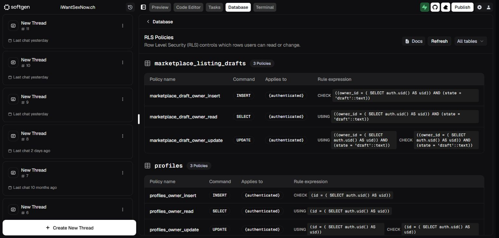
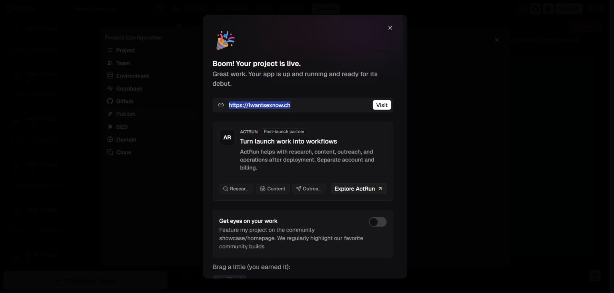
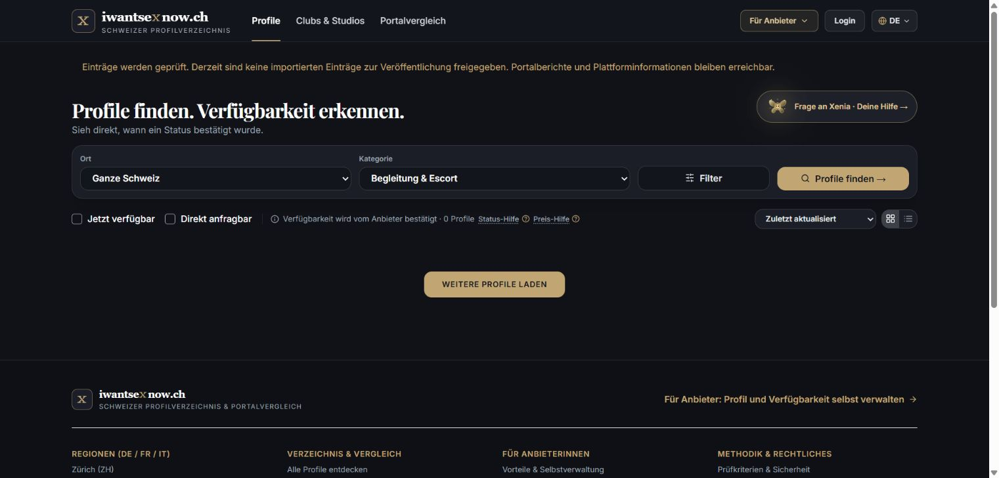
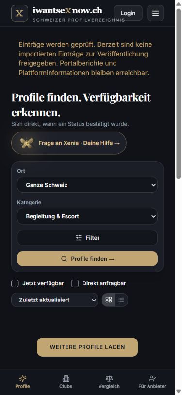

# P0 production receipt — 26 October 2026

Scope: the user explicitly approved the prepared profiles SQL correction, PR #16 merge and rollout into the same existing Softgen project. This is completion of that production package, not completion of the full Goal.

## Database

Applied the exact SQL blob `df97072efd65bf7ea3c1b619329354903b206892` from `docs/goal/sql/20261026_harden_existing_profiles.sql` through the integrated SQL Editor. The transactional schema/policy preflight completed. The console was restored to read-only immediately afterwards.

Actual readback: profiles count **0**, private drafts count **2**, both unchanged. Anonymous table SELECT and email-column SELECT **false**; authenticated email-column SELECT **true**, subject to owner RLS; service-role table SELECT **true**. The RLS view shows exactly `profiles_owner_read`, `profiles_owner_insert`, `profiles_owner_update`, authenticated only, each with `id = auth.uid()` ownership checks; UPDATE has both USING and WITH CHECK. Existing draft policies remain unchanged. No personal rows were viewed or copied, no fixtures created, no rows deleted.

A metadata query containing UPDATE/DELETE privilege strings was rejected by the read-only scanner. The accepted SELECT-only privilege readback and RLS UI supplied the above evidence; no encoding or bypass was used. Column-privilege inventory did not provide usable rows and is not claimed as separate proof. The isolated PostgreSQL suite supplies the detailed write-column/cross-user/destructive-operation coverage.

## Merge and managed source

- PR [#16](https://github.com/mfeie002-jpg/iwantsexnow/pull/16) merged with expected-head lock `756a80e57e85a3eb7f1531e1489619bbbadfcb9e`.
- Merge commit: `e08451b5c0ec969df720a00309195978da28eb1b`.
- Complete application/source tree: `a646abac25f6c3b17c6cddb269ccb89dca3e1f43`.
- Managed source was clean at original `14b9c417…`; retained as `backup/iwsn-before-p0-20261026`, fetched main with exact SHA check and checked out `release/iwsn-p0-20261026`. No hard reset/force pull or overwritten concurrent work.
- After deployment, Softgen reports managed commit `6fd6b36dd5855a4c1ea73ac033efe0859ecab9b9`, clean worktree, same complete tree. Do not infer a source-code difference from that metadata-only commit change.
- Locked install, actual managed production build, 354 built-page assertions and 1,422 route/asset assertions passed.
- Main CI [40292982854](https://github.com/mfeie002-jpg/iwantsexnow/actions/runs/40292982854): all 26 recorded steps successful, including the 114-test coverage and isolated PostgreSQL gate.

## Existing deployment

Used the existing Publish → Redeploy connection under Softgen's Vercel account; no new account/service/project, paid upgrade, ActRun action, showcase opt-in or environment change. The UI reported success on `https://iwantsexnow.ch`; its last-deployed label was “9:38 AM 26 October” verbatim. That UI timestamp is not treated as timezone or Git-SHA proof.

Fresh direct production acceptance: **62/62 HTTP cases passed**. Checks cover initial HTML canonical/og:url/noindex, absent cross-city hreflangs, truthful gated routes, real invalid/retired-ID 404s, anonymous admin/import denial, empty metrics/state, retired-token and legacy-action denial, invalid search handling, approved inventory empty, empty sitemap, analyzer authorization and disabled private-flow endpoints. Rejected synthetic payloads were sent only after the new empty metrics boundary was proven. No personal data was supplied.

See [machine-readable production acceptance](live-p0-acceptance-20261026.json) and [exact one-shot acceptance source](live-p0-acceptance-20261026.cjs). Existing localhost-only acceptance scripts remain unchanged.

- Next build: `bZY6C1DvzDlw-5GjkXsxs`.
- Deployment fingerprint: `dpl_77dg9UmDcsN6PssuxaNeBYMyWkqL`.
- Public app chunk `/_next/static/chunks/pages/_app-0113de5095c3e39e.js`, SHA-256 `09cc93111d204f7424c057ebce0dd27684d39e5af814911b590379e6365e57ca`, byte-identical to the managed build.
- The production platform's exact Vercel Git-SHA metadata was not exposed; full-tree reconciliation plus live boundary behavior and matching compiled app chunk are the evidence. Do not claim Vercel Git-SHA verification.

Desktop and mobile homepage spot-checks show the review notice, zero public listings and preserved dark/gold/X design. Mobile: client/scroll/body widths all 375px, no horizontal overflow; temporary viewport override restored. Full multi-route/mobile interaction acceptance is still open.

## Continuing boundaries

Public inventory remains quarantined, indexing withheld, reports/accounts/transactions gated, scheduled imports paused. Edge functions remain undeployed (0 in actual console). Do not apply the historical analyzer SQL or source migration directory to manufacture an absent schema.

Open: real role-backed operations, full durable source mapping/suppression/removal/reimport/restore, current live cross-user/persistence/concurrency acceptance, responsible operator/contact verification, Deno runtime checks and remaining Masterplan phases. The existing private-draft flag stays off. No new runner/scheduler/copy was created.

Recovery must retain corrected profile RLS, retired tokens/writers, empty approved projection and noindex. The preserved old-source ref is forensic recovery material, **not** a safe public rollback. No unsafe rollback or history rewrite performed.

## Concurrent merge repair

After the production acceptance, main moved to `22e5c22856744ad73f42848147a5605c497efa5e` (“go”), merging historical 25 October logo/theme commits into the approved P0 main. The merge committed **13 unresolved conflict blocks** across `public/favicon.svg`, `src/components/BrandLogo.tsx`, and `src/pages/index.tsx`, including invalid TSX and obsolete booking/verification copy on the alternate side. This run did not deploy that main.

Resolution selects only the incoming reviewed P0 side of each explicit conflict. Every resolved file exactly equals its approved `e08451b` blob; creating the repair tree from concurrent main reproduces complete tree `a646abac25f6c3b17c6cddb269ccb89dca3e1f43` exactly before these documentation receipts are added. No outside-conflict edits are removed; all original commits and alternate designs remain in history. The follow-up repair is checked through the existing CI before merging. The production SQL and deployed application are unchanged by this source repair.
